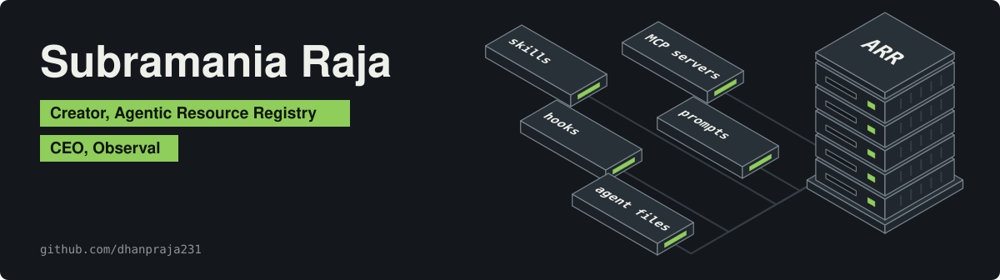

<picture>
  <source media="(prefers-color-scheme: light)" srcset="banner-light.svg">
  
</picture>

# Subramania Raja

- Creator of [Agentic Resource Registry](https://github.com/AgenticResourceRegistry/AgenticResourceRegistry) (formerly Observal), an open-source, self-hosted registry for teams to share and discover coding agent resources, with 3M+ downloads and a 2k+ member Discord
- Agentic Resource Registry is listed on the Agentic Resource Discovery (ARD) website's [Reference Implementations page](https://agenticresourcediscovery.org/ref_implementations/)
- CEO of Observal Inc.
- Built [kiro-cli-langfuse](https://github.com/dhanpraja231/kiro-cli-langfuse), Langfuse tracing for Kiro CLI, used in [Langfuse's integration guide](https://langfuse.com/integrations/developer-tools/kiro-cli)
- Speaker at [Open Source India 2026](https://www.opensourceindia.in/osi-speakers-2026/subramania-raja/)
