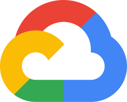
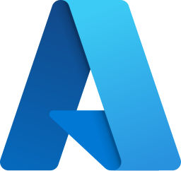

<picture>
  <source media="(prefers-color-scheme: light)" srcset="banner-light.svg">
  
</picture>

# Subramania Raja

- Creator of [Agentic Resource Registry](https://github.com/AgenticResourceRegistry/AgenticResourceRegistry) (formerly Observal), an open-source, self-hosted registry for teams to share and discover coding agent resources, with 3M+ downloads and a 2k+ member Discord
- Agentic Resource Registry is listed on the Agentic Resource Discovery (ARD) website's [Reference Implementations page](https://agenticresourcediscovery.org/ref_implementations/)
- CEO of Observal Inc.
- Built [kiro-cli-langfuse](https://github.com/dhanpraja231/kiro-cli-langfuse), Langfuse tracing for Kiro CLI, used in [Langfuse's integration guide](https://langfuse.com/integrations/developer-tools/kiro-cli)
- Speaker at [Open Source India 2026](https://www.opensourceindia.in/osi-speakers-2026/subramania-raja/)

## Supported by

<table>
<tr>
<td align="center" width="25%" height="90"></td>
<td align="center" width="25%" height="90"><a href="https://openai.com/startups"><picture><source media="(prefers-color-scheme: light)" srcset="badges/openai-light.svg"></picture></a></td>
<td align="center" width="25%" height="90"></td>
<td align="center" width="25%" height="90"></td>
</tr>
<tr>
<td align="center" valign="top" width="25%"><b>Entrepreneurs First</b> Founder in Residence</td>
<td align="center" valign="top" width="25%"><b>OpenAI for Startups</b> Startup program</td>
<td align="center" valign="top" width="25%"><b>Google for Startups Immersion</b> Powered by Antler</td>
<td align="center" valign="top" width="25%"><b>Google Cloud</b> Startup program</td>
</tr>
<tr>
<td align="center" width="25%" height="90"><a href="https://aws.amazon.com/activate/"><picture><source media="(prefers-color-scheme: light)" srcset="badges/aws-light.svg"></picture></a></td>
<td align="center" width="25%" height="90"></td>
<td align="center" width="25%" height="90"><a href="https://www.anthropic.com/"><picture><source media="(prefers-color-scheme: light)" srcset="badges/anthropic-light.svg"></picture></a></td>
<td align="center" width="25%" height="90"><a href="https://www.mintlify.com/"><picture><source media="(prefers-color-scheme: light)" srcset="badges/mintlify-light.svg"></picture></a></td>
</tr>
<tr>
<td align="center" valign="top" width="25%"><b>AWS Activate</b> Startup program</td>
<td align="center" valign="top" width="25%"><b>Microsoft for Startups</b> Startup program</td>
<td align="center" valign="top" width="25%"><b>Anthropic</b> Startup program</td>
<td align="center" valign="top" width="25%"><b>Mintlify</b> Startup program</td>
</tr>
</table>
